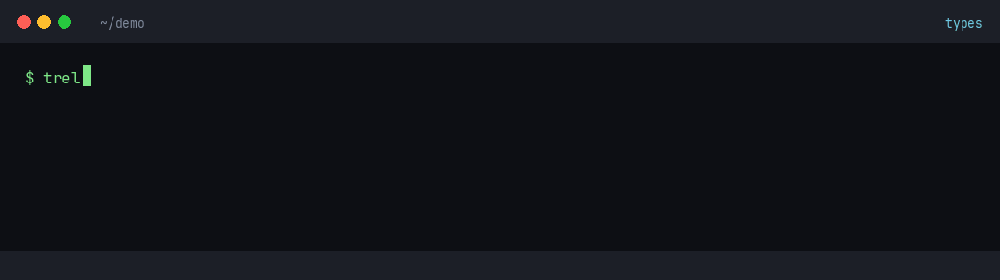

# trello-tickets

<h3 align="center">Seven ticket types baked in — no template card to read before filing one.</h3>

<p align="center">
  <a href="LICENSE"></a>
  
  
  
</p>

<p align="center">
  
</p>

## What it is

`trello-tickets` **creates and reads Trello cards** against a fixed vocabulary of ticket types:
User Story, Task, Documentation, Defect, Technical Debt, Spike, Distraction. Each type carries its
description sections, default checklist, labels and cover colour, so creating a well-formed card is one
command and needs no board read first.

## The problem it removes

Ticket templates live in someone's head or in a card you must open and copy before filing
anything. The result is half-filled cards: a Defect with no reproduction steps, a Spike with no question
to answer.

## Install

```bash
# Claude Code — the whole collection as one marketplace
claude plugin marketplace add Appit-labs/appit-skills
claude plugin install trello-tickets@appit-skills

# pi
pi install git:github.com/Appit-labs/trello-tickets

# any agent that reads a skills directory
git clone git@github.com:Appit-labs/trello-tickets.git
cp -r trello-tickets/skills/trello-tickets ~/.claude/skills/      # or ~/.codex/skills/, .cursor/skills/, …
```

## Use

- **Read** — `boards` · `lists "My Board"` · `cards "My Board" --list "Next Sprint"` · `card <id>`
- **Inspect a type** — `scripts/trello.py template "Defect Template"` — works offline
- **Create** — `scripts/trello.py create "My Board" --list "Next Sprint" --type "Task Template" --title … --dry-run`

## What it does not do

- It does not invent an eighth type; if nothing fits it says which two are closest.
- It does not keep credentials in the repo — they live in `~/.config/trello/config.json`, mode 600.

## Requires

- Python 3.9+ (stdlib only).
- A Trello API key and token: `scripts/trello.py login --key … --token …`.
- Network access to `api.trello.com`, or your own `TRELLO_API_BASE`.

## Cost

| | tokens |
| --- | --- |
| always-on — the description, paid every session | ~96 |
| on invoke | ~1k |

The demo above is not a mockup: `demos/trello-tickets.json` holds the captured run and
`tools/make_demo.py` renders it, so it can be regenerated and audited.

## Security

SkillSpector: **0/100, SAFE, 0 open findings** against the committed baseline. Every accepted
finding is listed with its reason in [SECURITY.md](SECURITY.md). No `shell=True`, no credential
storage, no network destination chosen at runtime.

## Part of the Appit collection

[appit-skills](https://github.com/Appit-labs/appit-skills) — browser QA · CI triage · Postgres · runbooks ·
SSH · Trello · cloud browsers · OpenDesign · Blender.

## License

MIT, copyright Appit Labs. See [LICENSE](LICENSE).
